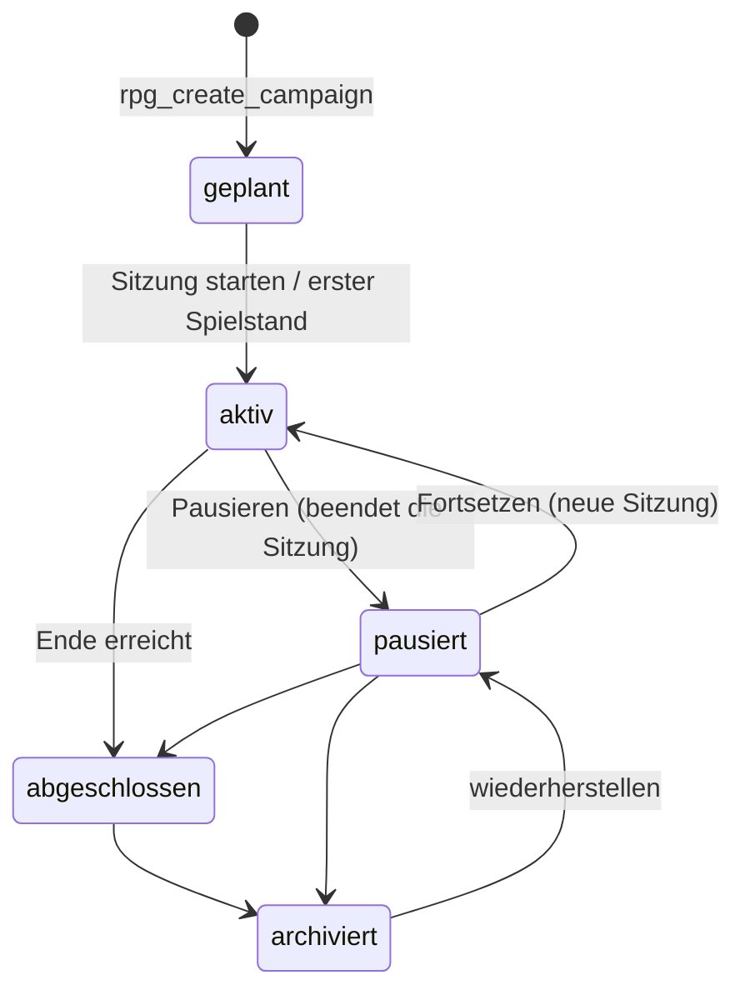

# RPG-Plattform · Technisches Umsetzungsdokument

**Grundlage:** Fachkonzept „RPG-Plattform, Schritte 1–3“ (Version 1.0, November 2026)
**Stand:** Entwurf 1 · November 2026 · gilt **nur für das RPG** („Das Siegel von Grauwacht“)

Dieses Dokument beschreibt, *wie* das Fachkonzept umgesetzt wird: Reihenfolge, Datenmodell, Funktionen, Rechte, Änderungen im Spiel, Tests und Einspielen. Für den ersten Bauabschnitt liegt das SQL fertig und lokal geprüft bei. Die späteren Abschnitte sind als Entwurf beschrieben und werden vor dem Bau genauso ausgearbeitet.

---

## 1. Entscheidungen

| Thema | Entscheidung |
|---|---|
| Testumgebung | **Keine.** Es wird direkt im bestehenden Supabase-Projekt gebaut. Ausgleich: siehe Abschnitt 9 (nur hinzufügen, nie ändern; Rückbau-Skript; lokale Prüfung jeder Migration; Freischaltung per Schalter). |
| Reihenfolge | **A** Kampagnen und Wiederaufnahme → **B** Konten und Profile → **C** Einladungen und Gastbeitritt → **D** Freunde. Abschnitt A kommt vor den Konten, weil er sofort nutzbar ist und ohne E-Mail und Datenschutz für Konten auskommt. |
| Gäste | Gäste sind **anonym angemeldete Supabase-Nutzer** (heute schon so). Eine eigene Gästetabelle mit eigenen Tokens entfällt. Jede Identität ist eine `user_id`; ein Gast kann später ein Konto werden und behält dabei seine ID. |
| Anmeldung und Abgrenzung | Dasselbe Supabase-Projekt, aber das RPG speichert seine Anmeldung **unter einem eigenen Schlüssel im Browser**. So meldet eine RPG-Anmeldung niemals Escape Rooms oder Krimidinner mit an (Details in Abschnitt 3). |
| Wer wendet die Regeln an | Der **Spieltisch** bleibt die Instanz, die Regeln anwendet und den Spielstand fortschreibt. Der Server sichert die Reihenfolge: Speichern nur mit der erwarteten Versionsnummer (optimistische Sperre). Eine Regelprüfung auf dem Server ist für Schritt 1–3 nicht nötig und erst für Spieler gegen Spieler vorgesehen. |
| Live-Verbindung | Bleibt technisch die bestehende Sitzungstechnik (`game_sessions` mit Spiel `abenteuer`, die das RPG heute schon allein nutzt). Neu ist die **dauerhafte Kampagne** daneben in eigenen `rpg_`-Tabellen. Bestehende Tabellen und Funktionen werden nicht verändert, nur gelesen. |

**Antworten auf die offenen Fragen (Fachkonzept Kapitel 12), bestätigt im November 2026:**

| Frage | Vorschlag |
|---|---|
| Aufbewahrung Gastdaten | RPG-Daten von Gästen ohne Aktivität werden nach **30 Tagen** gelöscht. Anonyme Benutzer selbst werden *nicht* gelöscht, weil Escape Rooms dieselbe Anmeldetechnik nutzen. |
| Gast hat schon ein Konto | Übernahme per **Übertragungscode** (Abschnitt B), nie stilles Überschreiben. |
| Wer darf pausieren / fortsetzen | Nur der **Host**. Fällt er dauerhaft aus, kann er die Host-Rolle übergeben (Abschnitt B, sobald es Konten gibt). |
| Mehrere Geräte je Spieler | Ein Handy je Spieler und Kampagne; ein zweites übernimmt die Rolle, das erste wird getrennt. Der Spieltisch darf ohne Konto laufen (dann als Gast). |
| Einladungen | Mehrfach nutzbar, **7 Tage** gültig, widerrufbar, an eine Kampagne gebunden. |
| Online-Status | Nur für bestätigte Freunde sichtbar. |
| Blockieren und Melden | Blockieren ab Start von Abschnitt D, Melden später. |

---

## 2. Ist-Stand (geprüft)

Abgelesen aus der echten Datenbank mit einem anonymen Testbenutzer und dem öffentlichen Schlüssel:

| Tabelle | Spalten | Rechte für Spieler |
|---|---|---|
| `game_sessions` | id, game_slug, room_code, status (waiting/running/closed), host_id, max_players, created_at, started_at, closed_at | eigene Sitzungen lesen; ändern verboten |
| `session_players` | session_id, user_id, player_name, is_host, joined_at | eigene Sitzungen lesen; ändern verboten |
| `session_state` | session_id, state_key, state, revision, updated_by, updated_at | lesen in eigenen Sitzungen; löschen verboten |
| `game_catalog` | slug, title, code_prefix, enabled, created_at | lesbar |

Funktionen: `create_game_session`, `join_game_session`, `start_game_session`, `leave_game_session`, `set_session_state`. Verlässt der Host, wird die Sitzung geschlossen. Das RPG startet seine Sitzung nie, sie bleibt im Status „waiting“. Dadurch können Handys jederzeit beitreten.

Heute speichert der Spieltisch den Spielstand nur **im Browser** (`localStorage`). Geht das Gerät verloren oder wird ein anderes benutzt, ist der Stand weg.

---

## 3. Architektur und Abgrenzung

```
Escape Rooms / Krimidinner  ──►  platform/multiplayer/mp-core.js  ──►  game_sessions, session_state …   (unverändert)

RPG (abenteuer/)            ──►  abenteuer/js/rpg-netz.js (neu)    ──►  game_sessions … (Live, nur wie heute)
                                 eigener Anmelde-Speicher                rpg_campaigns, rpg_state_snapshots … (neu)
```

- **Keine Änderung an gemeinsamen Dateien.** `platform/multiplayer/mp-core.js` und die Seiten der anderen Spiele bleiben unangetastet. Das RPG bekommt eine eigene Netzschicht `abenteuer/js/rpg-netz.js`: eine Kopie des heutigen Kerns plus Kampagnenfunktionen.
- **Eigener Anmelde-Speicher.** Supabase merkt sich die Anmeldung im Browser unter einem Schlüssel pro Projekt. Würde das RPG denselben Schlüssel nutzen, wäre eine spätere E-Mail-Anmeldung im RPG auch in den Escape Rooms aktiv. `rpg-netz.js` legt seine Verbindung deshalb mit `auth: { storageKey: "mr-rpg-auth" }` an.
  - Folge: Das RPG bekommt beim ersten Start eine **neue** anonyme Identität. Laufende Live-Runden aus der Zeit davor sind danach nicht mehr erreichbar. Das betrifft nur Runden, die gerade während der Umstellung laufen, und nur das RPG.
- **Alle neuen Datenbankobjekte** beginnen mit `rpg_`. Schreiben ist nur über `rpg_`-Funktionen erlaubt, lesen nur über Richtlinien (RLS).

---

## 4. Bauabschnitt A: Kampagnen, Spielstände, Wiederaufnahme

### 4.1 Datenmodell (Migration `abenteuer/supabase/001_rpg_kampagnen.sql`)

| Tabelle | Zweck | Wichtige Regeln |
|---|---|---|
| `rpg_campaigns` | Kampagne: Titel, Abenteuer, Host, Status, Schwierigkeit, `current_version`, `checkpoint` (Kurzinfo für die Bibliothek) | Status: geplant, aktiv, pausiert, abgeschlossen, archiviert. Kurzinfo höchstens 4 KB. |
| `rpg_campaign_members` | Spielerplatz: Rolle (host/spieler), Anzeigename, Figur, Status | genau ein aktiver Host je Kampagne; höchstens 8 aktive Plätze |
| `rpg_sessions` | Spielabend bzw. Verbindungsphase, Verweis auf die Live-Sitzung | **höchstens eine laufende Sitzung je Kampagne** (eindeutiger Index) |
| `rpg_state_snapshots` | versionierte Spielstände, Prüfsumme (md5), Art des Speicherpunkts | Stand höchstens 1 MB; es bleiben die letzten 20 plus die 10 jüngsten Lagerfeuer- und Kapitelstände |

Ein heutiger Spielstand ist etwa 20–60 KB groß; 1 MB lässt viel Luft.

### 4.2 Funktionen (Verträge)

Alle Funktionen prüfen `auth.uid()` und melden Fehler in verständlichem Deutsch. Ausführen dürfen nur angemeldete Nutzer, Gäste eingeschlossen.

| Funktion | Wer | Ergebnis | Wichtige Fehler |
|---|---|---|---|
| `rpg_create_campaign(p_title, p_difficulty, p_display_name, p_adventure)` | jeder angemeldete Nutzer | neue Kampagnen-ID; der Aufrufer ist Host | „bereits 20 Kampagnen“ |
| `rpg_start_session(p_campaign_id, p_game_session_id)` | Host; muss Host der Live-Sitzung sein | Sitzungs-ID. Läuft schon eine, wird sie „unterbrochen“, außer es ist dieselbe Live-Sitzung, dann kommt deren ID zurück | „nicht Host dieser Live-Sitzung“, „abgeschlossen/archiviert“ |
| `rpg_sync_members(p_campaign_id, p_members)` | Host | Anzahl übernommener Plätze; übernommen wird nur, wer **wirklich in der Live-Sitzung** ist | „bereits 8 Plätze“ |
| `rpg_save_snapshot(p_campaign_id, p_expected_version, p_state, p_kind, p_checkpoint)` | Host | neue Versionsnummer | `RPG_VERALTET:<n>`, wenn die erwartete Version nicht stimmt: dann wird **nichts** geschrieben. Höchstens 120 Speicherungen pro Minute |
| `rpg_load_campaign(p_campaign_id)` | aktive Mitglieder | Kampagne, Version, neuester Stand, Mitglieder | „gehörst nicht zu dieser Kampagne“ |
| `rpg_my_campaigns()` | jeder | eigene Kampagnen für die Bibliothek, ohne Spielstände | – |
| `rpg_set_campaign_status(p_campaign_id, p_status)` | Host | neuer Status; Pausieren und Abschließen beenden die laufende Sitzung | „Statuswechsel … nicht erlaubt“ |
| `rpg_reset_campaign(p_campaign_id)` | Host | Anzahl gelöschter Stände; Version 0, Mitglieder bleiben („Neu beginnen“) | – |
| `rpg_delete_campaign(p_campaign_id)` | Host | Kampagne samt Ständen, Sitzungen und Plätzen gelöscht | – |
| `rpg_leave_campaign(p_campaign_id)` | Mitspieler | Platz auf „ausgetreten“ | Host kann nicht verlassen |

### 4.3 Statusmodell



Sitzung: aktiv → beendet (Pausieren, Abschließen) oder unterbrochen (neue Sitzung, weil der Tisch neu geladen hat). Ein Verbindungsabbruch ändert **nicht** den Kampagnenstatus.

### 4.4 Rechte-Matrix

| | Host | Mitspieler | Fremder | nicht angemeldet |
|---|---|---|---|---|
| Kampagne, Mitglieder, Sitzungen, Stände lesen | ✓ | ✓ | – | – |
| Spielstand speichern | ✓ | – | – | – |
| Sitzung starten, Mitspieler übernehmen | ✓ | – | – | – |
| Pausieren, Status ändern, Neu beginnen, Löschen | ✓ | – | – | – |
| Kampagne verlassen | – | ✓ | – | – |
| Direkt in `rpg_`-Tabellen schreiben | – | – | – | – |

Hinweis: In Abschnitt A sehen alle Mitglieder den ganzen Spielstand. Geheime Entscheidungen werden schon heute erst am Ende aufgelöst und stehen nicht im öffentlichen Teil, der an die Handys geht. Wenn private Figurendaten dazukommen, wird der Stand in einen öffentlichen und einen privaten Teil je Spieler getrennt.

### 4.5 Speichern im Spiel

- **Speicherpunkte:** Szenenwechsel (`szene`), Entscheidung oder Abstimmung (`entscheidung`), Kampfende (`kampf`), Beute verteilt (`beute`), Lagerfeuer (`lagerfeuer`), neuer Abschnitt (`kapitel`). Dazu alle 60 Sekunden während eines Kampfs (`auto`), wenn sich etwas geändert hat.
- **Inhalt:** derselbe Stand, der heute im Browser liegt, also Abenteuer, laufender Kampf, Gruppe und Handy-Zuordnung. Dazu die Kurzinfo für die Bibliothek: Szene, Abschnitt, Stufe, Schwierigkeit, Gruppe.
- **Reihenfolge:** Der Tisch schreibt immer mit der zuletzt bestätigten Version. Gleichzeitig läuft höchstens ein Speichervorgang, weitere warten. So entstehen keine Lücken.
- **Konflikt (`RPG_VERALTET`):** Ein anderes Gerät hat neuer gespeichert, zum Beispiel ein zweites Tablet als Tisch. Der Tisch lädt den neueren Stand und meldet: „Auf einem anderen Gerät wurde weitergespielt. Der neueste Stand wurde geladen.“
- **Offline:** Der Stand bleibt zusätzlich im Browser. Gelingt das Speichern nicht, zeigt der Tisch einen Hinweis („nicht gespeichert“) und versucht es beim nächsten Speicherpunkt erneut. Beim Wiederherstellen gilt die letzte **bestätigte** Version.
- **Alter Browser-Spielstand:** Liegt beim ersten Öffnen ein Abenteuer im Browser, bietet das Spiel „Als Kampagne speichern“ an.

### 4.6 Oberfläche (Änderungen im RPG)

| Stelle | Änderung |
|---|---|
| Hauptmenü | Neuer Punkt **„Meine Kampagnen“**: Liste mit Titel, Szene, Abschnitt, Stufe, Schwierigkeit, Gruppe, zuletzt gespeichert und Status. Aktionen: Fortsetzen, Neu beginnen, Archivieren, Löschen. |
| Start eines Abenteuers | Titel vergeben, zum Beispiel „Grauwacht mit Freunden“; die Kampagne wird angelegt. |
| Während des Spiels (Szenenkopf, Kampfleiste, Heldenwahl) | **Pausieren** (speichert, beendet die Sitzung, Handys zeigen „Pause“) und **Neu beginnen** (mit Rückfrage). Dazu der Hinweis „gespeichert · vor 10 Sekunden“. |
| Handy | Bei Pause der Hinweis „Der Tisch hat pausiert“. Nach dem Fortsetzen treten die Handys mit dem neuen Code bei und bekommen ihren alten Platz samt Figur zurück, sofern sie dieselbe Identität haben (gleicher Browser). |

Dateien: `abenteuer/js/rpg-netz.js` (neu), `abenteuer/js/kampagnen.js` (neu: Bibliothek und Speicherlogik), Anpassungen in `spiel.js`, `abenteuer-tisch.js`, `handy.js`, `index.html`, `handy.html`, `css/abenteuer.css`. **Keine** Änderungen außerhalb von `abenteuer/`.

### 4.7 Tests

- **Datenbank (lokal, fertig):** `abenteuer/supabase/tests/pruefen.sh` spielt die Migration in ein lokales Postgres mit einer Nachbildung von Supabase ein, zweimal, um die Wiederholbarkeit zu prüfen. Dann laufen 40 Prüfungen zu Rechten, Versionen, Statuswechseln, Aufräumen, Neu beginnen, Löschen und Grenzen, zum Schluss der Rückbau. **Ergebnis: alles bestanden.**
- **Browser gegen die echte Datenbank (im Bau):** neuer Test `tests/live-kampagnen.test.js`.
  - Kampagne anlegen und spielen, Spielstand in Supabase vorhanden.
  - Pausieren, danach Browser-Speicher leeren und über „Meine Kampagnen“ fortsetzen: gleiche Szene, gleiche Gruppe.
  - Versionskonflikt zwischen zwei Tischen auslösen.
  - Neu beginnen, Löschen.
  - Fremder Benutzer sieht nichts.
- **Regression (Pflicht vor jeder Veröffentlichung):** alle vier bestehenden RPG-Tests sowie die Multiplayer-Tests von Krimidinner (`krimidinner/tests/live-krimidinner.test.js`, `krimidinner/eichenfels/tests/live.test.js`) und der Escape Rooms.

### 4.8 Abnahme Abschnitt A

1. Eine Kampagne kann pausiert, von allen Geräten verlassen und später auf demselben Gerät fortgesetzt werden; der Fortschritt ist gleich.
2. Ein Verbindungsabbruch beendet die Kampagne nicht.
3. Es entsteht nie eine zweite laufende Sitzung mit widersprüchlichem Stand. Ein veralteter Speichervorgang überschreibt nichts.
4. Fremde sehen keine Kampagne.
5. Escape Rooms und Krimidinner verhalten sich vorher und nachher gleich; ihre Tests sind grün.

> Geräteübergreifend fortsetzen geht erst mit Konten (Abschnitt B). Bis dahin ist die Kampagne an die Gast-Identität des Browsers gebunden, der sie eröffnet hat.

---

## 5. Bauabschnitt B: Konten und Profile

**Entscheidung (November 2026): Anmeldung nur mit Benutzername und Passwort, ohne E-Mail.** Eine E-Mail im Konto zu hinterlegen (für „Passwort vergessen“) folgt später. Einen Wiederherstellungscode gibt es vorerst nicht.

**Gestaltung:** Startbildschirm „Mythara – Das digitale Rollenspiel“ nach Vorlage. Links Anmelden (Benutzername, Passwort, „Passwort vergessen?“ mit ehrlichem Hinweis) bzw. „Angemeldet als …“ mit Abmelden. Rechts „Als Gast spielen“, darunter „Noch kein Konto? Jetzt registrieren“.

- **Benutzername** (Migration `002_rpg_profile.sql`, Tabelle `rpg_profiles`):
  - 3–20 Zeichen aus Buchstaben (auch ÄÖÜäöüß), Ziffern und `_`.
  - Jeder Name nur einmal; Groß und Klein zählen beim Vergleich gleich. Reservierte Namen sind gesperrt.
  - Sichtbar nur für Mitspieler gemeinsamer Kampagnen. In Kampagnen erscheint der Benutzername statt des Gerätenamens.
- **Technik:** Supabase verlangt für Passwörter eine E-Mail. Jedes Konto bekommt deshalb intern die feste Platzhalter-Adresse `m<user_id>@spieler.case-unlocked.de`. Sie ist unsichtbar, und es werden keine Mails dorthin geschickt. Beim Anmelden liefert `rpg_login_email(name)` diese Adresse, aber nur für echte Konten.
- **Registrieren:**
  1. `rpg_set_profile(name)` reserviert den Namen für den Gast.
  2. `auth.updateUser({ email: Platzhalter, password })` macht den Gast zum Konto. Die ID bleibt gleich, die Kampagnen bleiben erhalten.
  3. Wer den Vorgang nicht abschließt, verliert die Reservierung nach 2 Tagen.
- **Anmelden / Abmelden:** `signInWithPassword` bzw. `signOut`, danach wird die Seite neu geladen. Wer abmeldet, spielt als neuer Gast weiter.
- **Voraussetzung im Dashboard:** Authentication → Sign In / Providers → Email an, **„Confirm email“ aus**. Ein Mail-Dienst ist nicht nötig.
- **Später:**
  - E-Mail hinterlegen (dann Mail-Dienst).
  - Gast-Kampagnen von einem zweiten Gerät übertragen.
  - Konto löschen, Host übergeben.
  - Anmelden auf dem Handy.
  - Bot-Schutz (Captcha) vor dem öffentlichen Start.
  - Datenschutzerklärung für Konten.

## 6. Bauabschnitt C: Einladungen und Gastbeitritt (Entwurf)

- **Tabelle `rpg_invites`:** `campaign_id`, `created_by`, `token_hash` (SHA-256), Art (`link` oder `benutzer`), `intended_user_id`, `expires_at` (Standard 7 Tage), `revoked_at`, `max_uses`, `use_count`.
- **Token:** 32 Zufallsbytes, Base64url. Im Link oder QR-Code steht nur das Token, nie persönliche Daten. In der Datenbank liegt nur der Hash.
- **Funktionen:**
  - `rpg_create_invite`: nur der Host; höchstens 20 offene Einladungen je Kampagne.
  - `rpg_redeem_invite(p_token, p_display_name)`: funktioniert für Gäste und Konten; prüft Ablauf, Widerruf, Nutzungen und freie Plätze.
  - `rpg_revoke_invite`.
- **Gastbeitritt:** Der Host legt fest, ob Gäste erlaubt sind und wie viele Plätze frei sind. Wer beitritt, erhält nur die Daten seines eigenen Platzes.
- **Begrenzung:** höchstens 10 Einlöseversuche pro Minute je Nutzer, gegen Durchprobieren.

## 7. Bauabschnitt D: Freunde (Entwurf)

- **Tabelle `rpg_friendships`:** `requester`, `addressee`, Status (pending, accepted, declined, blocked), Zeitstempel; je Paar nur ein Eintrag.
- **Funktionen:** `rpg_find_player(handle)` liefert nur exakte Treffer, keine Listen. Dazu `rpg_request_friend`, `rpg_answer_friend`, `rpg_remove_friend` und `rpg_block`. Wer blockiert ist, kann weder Anfragen noch Einladungen schicken.
- **Begrenzung:** höchstens 20 Anfragen pro Tag. Den Online-Status sehen nur bestätigte Freunde.

---

## 8. Aufbewahrung und Aufräumen

Ein täglicher Job (`pg_cron`, Abschnitt B) räumt auf:
- Er löscht Kampagnen, deren Host ein **Gast** ist und die seit 30 Tagen nicht gespeichert wurden.
- Er beendet Sitzungen, die seit 24 Stunden „aktiv“ sind, ohne dass gespeichert wurde.
- **Anonyme Benutzer selbst werden nicht gelöscht**, weil Escape Rooms und Krimidinner dieselben Benutzer verwenden. Das bleibt deren eigener Ablauf.

---

## 9. Einspielen ohne Testumgebung

Weil direkt in der echten Datenbank gebaut wird, gelten diese Schutzregeln:

1. **Nur hinzufügen:** Jede Migration legt ausschließlich neue `rpg_`-Objekte an. Kein `alter` und kein `drop` an bestehenden Objekten, keine Änderung an Daten anderer Spiele.
2. **Wiederholbar:** Jede Migration darf mehrfach laufen (`if not exists`, `create or replace`).
3. **Rückbau-Skript:** Zu jeder Migration gibt es ein Skript, das nur ihre Objekte entfernt (`001_rpg_kampagnen_rueckbau.sql`).
4. **Lokal geprüft:** Jede Migration läuft vorher mit Tests gegen ein lokales Postgres (`pruefen.sh`). Erst wenn alles grün ist, bekommst du sie zum Einspielen.
5. **Sicherung vorher:** Im Supabase-Dashboard unter „Database → Backups“ nachsehen, ob es eine aktuelle Sicherung gibt. Im kostenlosen Tarif gibt es keine automatischen Sicherungen. Weil nur neue Tabellen entstehen, ist das Risiko für bestehende Daten gering, aber nicht null.
6. **Freischaltung per Schalter:** Die neuen Funktionen im Spiel erscheinen zuerst nur mit `?kampagnen` in der Adresse. Erst nach den Tests werden sie für alle sichtbar.
7. **Regression:** Nach dem Einspielen laufen alle RPG-, Escape-Room- und Krimidinner-Tests gegen die echte Datenbank.

**Ablauf je Migration:**
1. Ich schreibe die Datei, prüfe sie lokal und lege sie dir vor.
2. Du führst sie im SQL Editor aus.
3. Ich prüfe mit dem öffentlichen Schlüssel, dass Funktionen und Rechte wirken.
4. Erst dann baue ich die Oberfläche und teste gegen die echte Datenbank.

---

## 10. Risiken

| Risiko | Gegenmaßnahme |
|---|---|
| Fehler in einer Migration ohne Testumgebung | Nur hinzufügen, lokale Prüfung, Rückbau-Skript, Sicherung |
| RPG-Anmeldung wirkt in anderen Spielen | eigener Anmelde-Speicher `mr-rpg-auth`, eigene Netzschicht |
| Zwei Tische schreiben gleichzeitig | Versionsprüfung `RPG_VERALTET`, neuester Stand gewinnt, nichts wird stillschweigend überschrieben |
| Datenbank wächst | 20 Stände je Kampagne, 1 MB je Stand, 20 Kampagnen je Nutzer, Aufräumjob |
| Gast verliert Browser-Daten | Hinweis in der Bibliothek: „Mit einem Konto auf allen Geräten“ (ab Abschnitt B) |
| Datenschutz bei Konten | Abschnitt B erst nach Klärung von Mail-Dienst, Datenschutzerklärung, Altersgrenze |

---

## 11. Lieferumfang dieses Dokuments

| Datei | Inhalt |
|---|---|
| `abenteuer/UMSETZUNG-KAMPAGNEN.md` | dieses Dokument |
| `abenteuer/supabase/001_rpg_kampagnen.sql` | Migration Abschnitt A, **zum Einspielen bereit** |
| `abenteuer/supabase/001_rpg_kampagnen_rueckbau.sql` | Rückbau, falls nötig |
| `abenteuer/supabase/tests/pruefen.sh` | lokale Prüfung (Nachbildung, zweimal einspielen, 40 Prüfungen, Rückbau) |
| `abenteuer/supabase/tests/supabase_nachbildung.sql`, `001_rpg_kampagnen_test.sql` | nur für lokale Tests, **nicht** in Supabase ausführen |

**Nächster Schritt:** Die Entscheidungen in Abschnitt 1 sind bestätigt. Als Nächstes spielst du `001_rpg_kampagnen.sql` ein. Danach prüfe ich die Datenbank und baue die Oberfläche (4.5–4.6) hinter dem Schalter `?kampagnen`.
